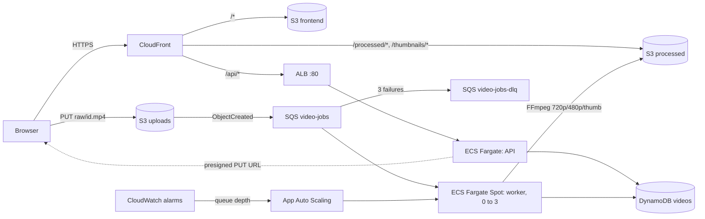

# Video Platform: Upload, Transcode & Stream on AWS

Upload an MP4 in the browser. It is transcoded to 720p and 480p with a thumbnail, then streamed through CloudFront. Infrastructure is defined in Terraform, and every push to `main` is tested, scanned and deployed by GitHub Actions.

## Architecture



**Flow:**
1. The page calls `POST /api/videos`. The API writes a DynamoDB item (`uploaded`) and returns a presigned S3 PUT URL.
2. The browser uploads the file straight to S3 (`raw/{id}.mp4`).
3. S3 sends an event to SQS. The queue-depth alarm scales the worker service up from 0.
4. The worker sets the status to `processing` and runs FFmpeg. It uploads the outputs, sets `ready` and deletes the message.
5. If a job fails, the worker sets `failed` and leaves the message on the queue. SQS retries it, and after 3 failures it moves to the DLQ.
6. The page polls `GET /api/videos` every 5s and plays the CloudFront URLs.

### Cost decisions
| Choice | Why |
|---|---|
| Public subnets, no NAT Gateway | Saves ~$32/month. Security groups block inbound to the workers, and the API accepts traffic only from the ALB. |
| Worker on Fargate Spot, scale to zero | Costs nothing while idle and is ~70% cheaper while running. |
| One CloudFront distribution with 3 origins | Serves the frontend, the media and the API from one HTTPS origin. |
| Raw uploads expire after 3 days, ECR keeps 5 images | Storage stays near zero. |
| `terraform destroy` after each session | The ALB (~$0.55/day) and the API task are the only always-on costs. |

## Repository layout
```
services/api        FastAPI service (routes at / and /api)
services/worker     SQS poller + FFmpeg transcoder
services/frontend   Static HTML/CSS/JS (config.js holds the API base URL)
infra/terraform     All AWS resources
../.github/workflows  ci-deploy.yml, rollback.yml, infra.yml (at the git repo root)
scripts/            LocalStack bootstrap for docker-compose
```

---

## 1. Run locally (free, no AWS account)

Requires Docker Desktop.

```sh
docker compose up --build
```
Open http://localhost:3001 and upload a short MP4. Within a few seconds the card goes from `uploaded` to `processing` to `ready`.

- API: http://localhost:8000/docs
- LocalStack: http://localhost:4566 (S3, SQS and DynamoDB)
- Worker logs: `docker compose logs -f worker`

Run the unit tests without Docker:
```sh
cd services/api    && pip install -r requirements-dev.txt && pytest && ruff check .
cd services/worker && pip install -r requirements-dev.txt && pytest && ruff check .
```

## Quick path: one command

Once `aws configure` and `gh auth login` are done:
```sh
./scripts/bootstrap-aws.sh    # state bucket, terraform apply, GitHub repo + variables, first deploy
./scripts/teardown-aws.sh     # end of every session: destroys everything (stops credit usage)
```
Sections 2–5 below are the same steps done by hand.

## 2. One-time AWS bootstrap (manual)

1. **Budget alert:** AWS Console, then Billing, then Budgets, then *Zero spend budget*, with your email.
2. **Admin user for your laptop:** IAM, then Users, then `terraform-admin` with `AdministratorAccess`. Create a CLI access key, then run:
   ```sh
   brew install awscli terraform     # Terraform >= 1.10
   aws configure                     # region: ap-south-1, output: json
   ```
3. **Terraform state bucket:**
   ```sh
   aws s3api create-bucket --bucket video-platform-tfstate-<initials> \
     --region ap-south-1 --create-bucket-configuration LocationConstraint=ap-south-1
   aws s3api put-bucket-versioning --bucket video-platform-tfstate-<initials> \
     --versioning-configuration Status=Enabled
   ```

## 3. Provision AWS with Terraform

```sh
cd infra/terraform
cp terraform.tfvars.example terraform.tfvars    # set github_repo and tf_state_bucket
terraform init -backend-config="bucket=video-platform-tfstate-<initials>"
terraform apply
```
The first apply takes about 5–10 minutes, mostly CloudFront. The API service has no image yet, so it fails to start until step 5 deploys one. That is expected.

> The OIDC provider for `token.actions.githubusercontent.com` can exist only once per AWS account. If you already created one, import it first: `terraform import 'aws_iam_openid_connect_provider.github[0]' arn:aws:iam::<account>:oidc-provider/token.actions.githubusercontent.com`

## 4. Connect GitHub

Create the GitHub repo and push this folder to it. Then go to **Settings → Secrets and variables → Actions → Variables** and add:

| Variable | Value |
|---|---|
| `AWS_ROLE_ARN` | `terraform output -raw github_actions_role_arn` |
| `AWS_REGION` | `ap-south-1` (optional, this is the default) |
| `TF_STATE_BUCKET` | your state bucket name (used by `infra.yml`) |

You don't need to store the ALB DNS name, the frontend bucket or the CloudFront ID. The workflows look them up by name on every run, so they keep working after a `destroy`/`apply` cycle. You can still set `ALB_DNS_NAME`, `FRONTEND_BUCKET`, `CLOUDFRONT_DIST_ID` or `ECS_CLUSTER` as variables to override the lookup.

## 5. Deploy

- **First deploy, or after recreating the stack:** go to Actions, then **CI / Deploy**, then **Run workflow**. This builds and deploys everything.
- **After that:** `git push origin main` deploys only the services you changed.

Pipeline steps: path filter, then ruff and pytest, then a Docker build, then a Trivy scan (fails on fixable CRITICAL vulnerabilities), then an ECR push (tagged with the commit SHA and `latest`), then an ECS deploy that waits for stability and checks for a rollback, then the S3 sync with a CloudFront invalidation, and finally smoke tests on `/health`.

Open the app at `terraform output -raw cloudfront_url`.

## 6. Rollback

- **Automatic (API):** the ECS deployment circuit breaker rolls back a revision that fails ALB health checks. CI then fails with *"Deployment was rolled back"*.
- **Manual:** go to Actions, then **Rollback**, then **Run workflow**. Pick `api` or `worker`, and optionally a revision. A blank revision means the current revision minus 1.
- **Failed jobs:** go to the SQS console, then `video-jobs-dlq`, then **Start DLQ redrive**, to send them back to `video-jobs`.

## 7. Teardown (do this every time you finish)

```sh
cd infra/terraform && terraform destroy
```
Buckets and ECR repos are force-deleted, so the destroy completes in one run. Next time, run `terraform apply` and then **Run workflow** on CI / Deploy.

## Demo checklist
1. `docker compose up --build` shows the stack running fully offline.
2. `terraform apply` brings the AWS stack online.
3. Edit `index.html` and push. The GitHub Actions run shows OIDC, tests, Trivy, ECR, ECS and S3.
4. Show the ECS console with 0 worker tasks. Upload a 15s 1080p clip, watch the queue alarm scale workers from 0 to 1 and the status go `uploaded`, `processing`, `ready`. Play both 720p and 480p.
5. Make `/health` return 500 (for example `raise HTTPException(500)`) and push. The circuit breaker rolls back automatically.
6. Run **Rollback** from the Actions UI, and show a DLQ redrive.
7. Run `terraform destroy`.

## AWS Academy Learner Lab
Learner Lab blocks IAM role creation, so set `use_learner_lab = true` in `terraform.tfvars`. All tasks then use `LabRole`, and the GitHub OIDC role is not created. Learner Lab only allows `us-east-1`, so also set `aws_region = "us-east-1"`, change `region` in the `backend "s3"` block, and set the `AWS_REGION` variable to `us-east-1`. In GitHub, leave `AWS_ROLE_ARN` unset and add secrets `AWS_ACCESS_KEY_ID`, `AWS_SECRET_ACCESS_KEY` and `AWS_SESSION_TOKEN` from the lab's *AWS Details* panel. Refresh them each lab session. Also set the variable `USE_LEARNER_LAB=true`.

## Notes on deviations from the original plan
- **The API is served through CloudFront at `/api/*`.** The plan had the page call `http://<ALB>` directly, but browsers block plain-HTTP calls from an HTTPS page (mixed content). CI writes `config.js` with `API_BASE_URL = "/api"`, and the ALB still serves `/health` for health checks and smoke tests.
- **Trivy runs from the pinned `aquasec/trivy` container** instead of `aquasecurity/trivy-action`. It runs before AWS credentials are loaded into the job, so a compromised scanner cannot read them.
- **Test dependencies are in `requirements-dev.txt`**, which keeps them out of the production images.
- **Upload progress uses `XMLHttpRequest`**, because `fetch` cannot report upload progress.
